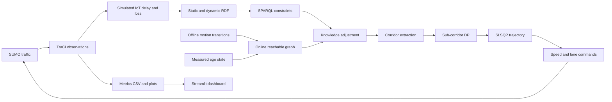
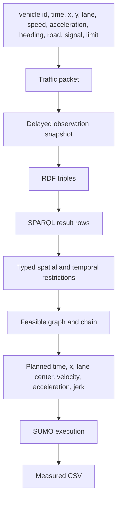
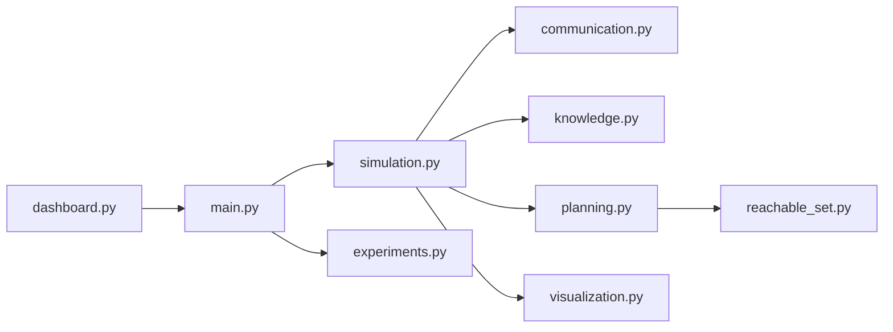
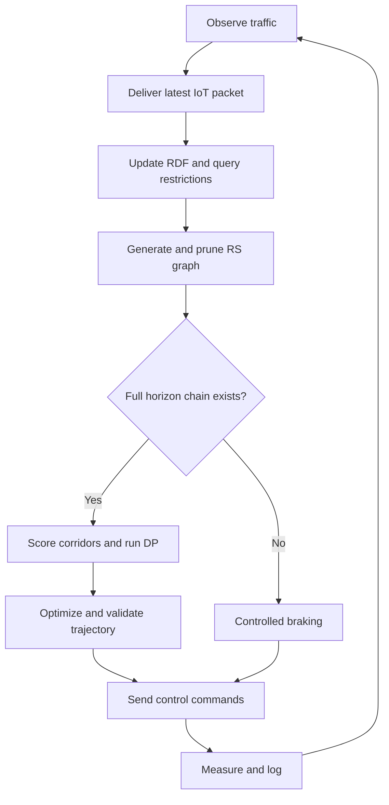
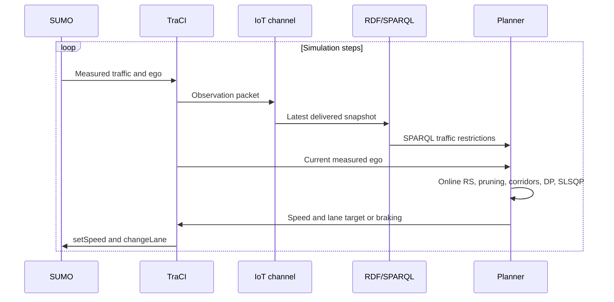
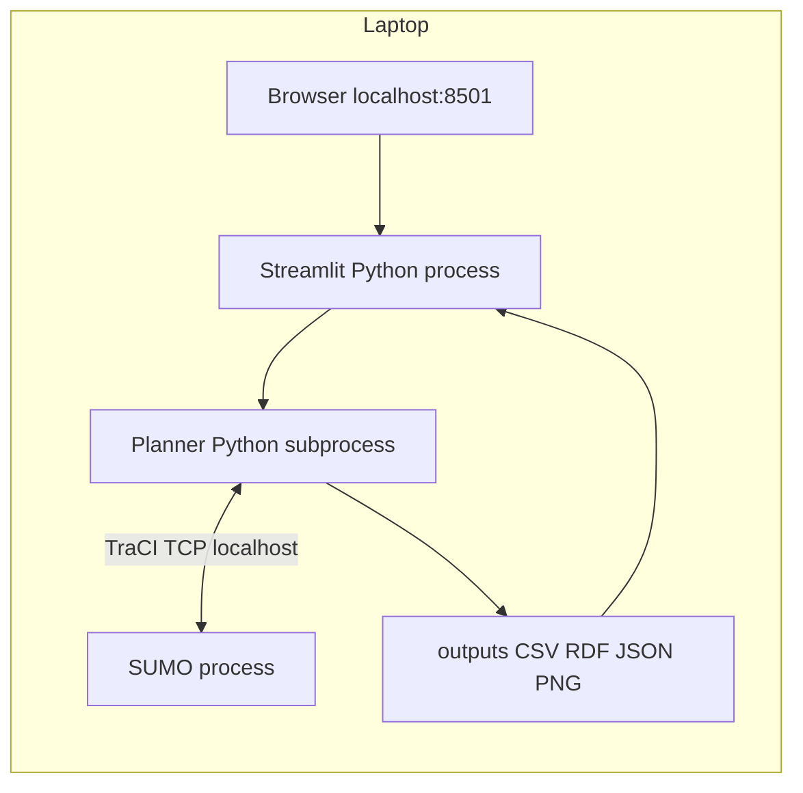

# Architecture diagrams

## System architecture

## Data flow

## Module diagram

## Algorithm flowchart

## Sequence diagram

## Deployment

SUMO provides traffic dynamics and signals; TraCI supplies observations and commands. The channel is simulated IoT transport. RDF stores facts, SPARQL retrieves actual planner restrictions, and the separate motion modules produce feasible sampled states. Metrics compare executed behavior; dashboard displays saved live snapshots. Deployment requires one laptop and no cloud service.
